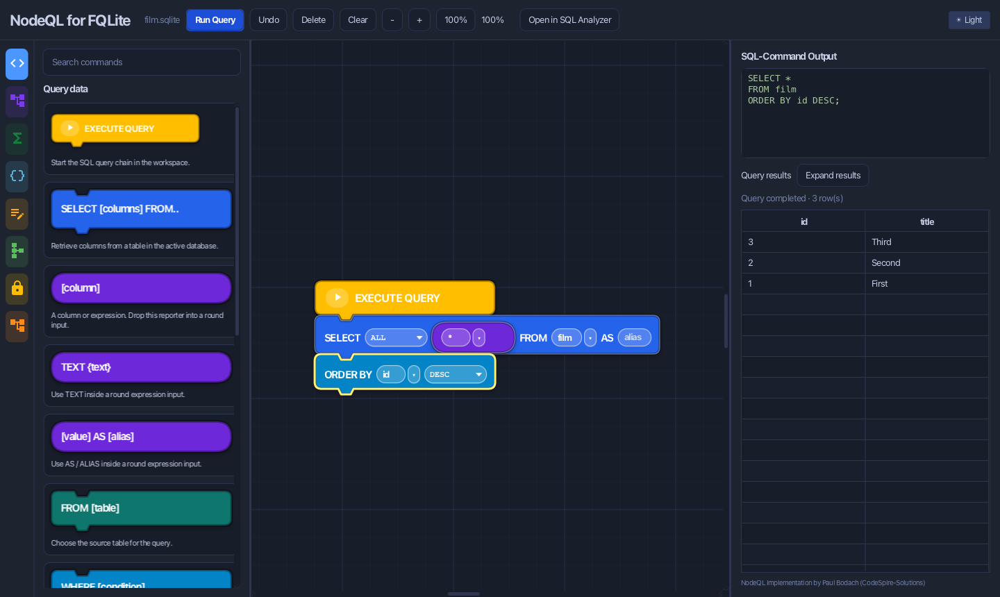
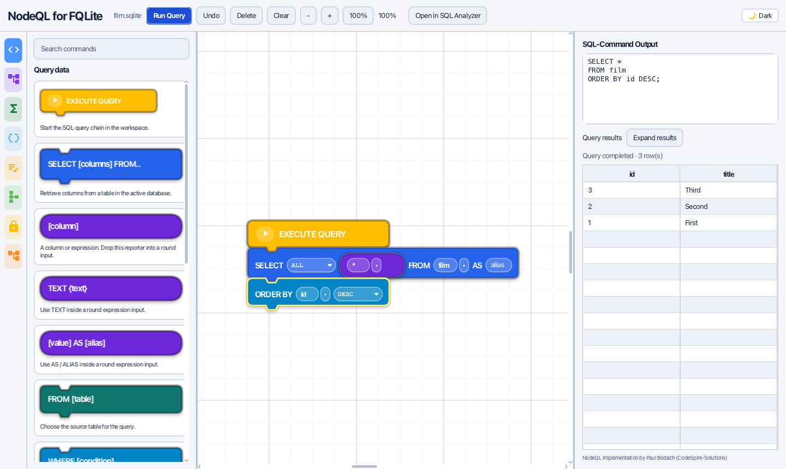

# PR title

Release 5.1: align NodeQL editor with upstream and execute queries in place

# PR body

## Summary

Update FQLite's JavaFX NodeQL integration to follow the current NodeQL workbench
and let users execute visual queries without switching to the SQL Analyzer.
Prepare the application as version 5.1.

## Changes

- Add a NodeQL graph icon to the main toolbar; remove the separate top-menu entry.
- Rework the dark editor with resizable panels, a category rail, searchable block
  cards, upstream-inspired puzzle geometry, oval reporters and selection outlines.
- Support reporter insertion, detachment, nesting and undo, plus content-aware
  block sizes and shape-aware snapping.
- Add structured conditions, sorting direction, DISTINCT, table aliases,
  LIMIT/OFFSET, and text, alias and SQLite-function reporters.
- Execute queries directly with inline results and an optional expanded result
  view. Keep the SQL Analyzer as an optional hand-off.
- Keep nodes session-only: no NodeQL workspace persistence in project files.
- Keep the workspace camera stable during node dragging, panel resizing and zoom;
  separate block dragging from explicit right/middle-button canvas panning.
- Suggest existing tables/views in all table inputs with live filtering, schema
  refresh and identifier quoting, while retaining unrestricted custom SQL input.
- Suggest columns in SELECT, filters, grouping, sorting, JOINs and expression
  reporters. Respect table aliases, omit ambiguous bare JOIN names, preserve
  previous SELECT list entries and keep custom SQL fully editable.
- Share the main application's Light/Dark setting and toggle styling, with live
  synchronization across the main app, builders and expanded results. No separate
  NodeQL theme preference or new restart persistence is introduced.
- Bundle Material Icons with its Apache 2.0 license.
- Update README, changelog, integration guide, screenshot and verification notes.
- Align Gradle and application version metadata to 5.1 (2026-10-11).

## Screenshot

Current NodeQL for FQLite editor, captured on 2026-10-30 with a sample query and
inline SQLite results. Only generated test data is shown.

## Validation

- JDK 21: `./gradlew --no-daemon compileJava processResources nodeQlSmokeTest`.
- 175 JavaFX/SQLite checks: block sizes and alignment, reporter drop targets,
  insertion/detachment, nested undo, SQL generation, quoting, SQLite function
  execution, inline result shape/order and content bounds; shared theme state,
  two-way toggles, multiple windows, rendered block text and scene cleanup;
  detach/reattach mouse gestures at three zoom levels, viewport stability, panning,
  table/column inputs, live filtering, identifier escaping and custom expressions;
  alias-qualified JOIN execution, multi-column projections, generated/view/temp
  columns, table/schema changes and nested reporter undo.
- The camera regression fails against `eeedb33` and passes with this fix.
- Smoke test uses only a temporary in-memory database and closes its editor.
- Visual comparison against NodeQL commit
  `bfbb70c5a6e4035041af05809d2f0f28f484aabd` (upstream version 0.4.3+2).

## Scope and release notes

This is a JavaFX integration, not a replacement with the standalone Flutter app.
Native pointer automation, every legacy SQL template and other display densities
have not been exhaustively tested. The upstream/bundled FQLite PDF manual is
unchanged; the integration guide covers the updated NodeQL workflow.

Version metadata is prepared for 5.1. Signed installers and the GitHub release
remain a separate release workflow; this PR does not publish them.
